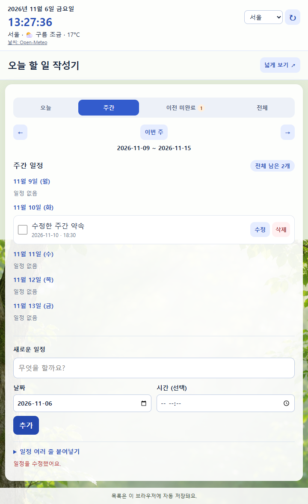
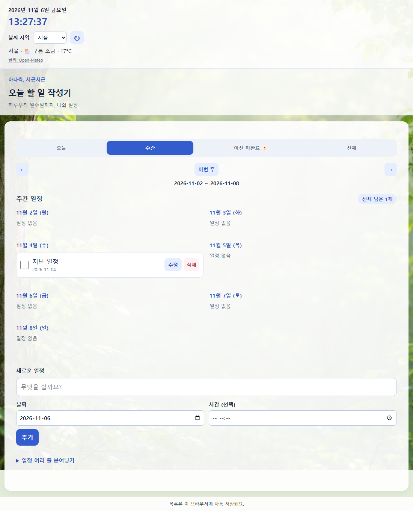

# 일 — 오늘 할 일 작성기

## 한 줄 소개

오늘과 주간 일정을 기록하고 완료 여부와 이전 미완료 일정을 확인하는 한국어 크롬 확장 프로그램입니다.

## 누구를 위해 만들었나요

매일 할 일을 빠르게 적고, 한 주의 약속과 놓친 일정을 함께 관리하고 싶은 사람을 위해 만들었습니다.

## 주요 기능

- 날짜와 시간을 지정한 일정 추가·수정·삭제, 완료 체크와 남은 개수 표시
- 오늘·주간·이전 미완료·전체 보기, 이전 주·다음 주 이동
- 여러 줄 일정 붙여넣기, 빈칸 추가 방지, 브라우저를 다시 열어도 목록 유지
- 현재 날짜·시간과 선택한 지역의 날씨 표시

## 화면

아래 캡처는 기능 확인용 예시 일정으로 촬영한 화면입니다. 날씨는 화면 테스트용 예시 값입니다.

## 강사 예시에서 바꾼 점

- 초록 나무 배경과 파란색 포인트를 적용하고 글씨 크기를 조정했습니다.
- 팝업 폭을 720px로 변경하고 넓게 보기에서는 창 크기에 맞춰 배치되도록 했습니다.
- 일정 목록을 먼저 표시하고, 새 일정과 여러 줄 추가 입력 영역은 하단으로 옮겼습니다.
- 날짜·시간, 날씨, 일정 수정, 주간 보기, 이전 미완료 확인 기능을 추가했습니다.
- 날짜 없는 기존 일정은 전체 보기에서 날짜 미지정으로 유지합니다.

## 써 보는 법

1. 크롬의 chrome://extensions/에서 개발자 모드를 켜고 압축해제된 확장 프로그램 로드로 이 폴더를 선택합니다.
2. 확장 아이콘 '일'을 열어 하단에서 내용·날짜·시간을 입력하고 추가를 누릅니다.
3. 오늘·주간·이전 미완료·전체 보기를 선택하고 각 일정의 완료 체크·수정·삭제를 사용합니다.

날씨 기본 지역은 서울이며 변경한 지역은 저장됩니다. 날씨 조회에는 인터넷 연결이 필요합니다. 날씨 제공: [Open-Meteo](https://open-meteo.com/).
목록은 설치한 브라우저의 로컬 저장소에 보관됩니다. 채팅과 자동으로 연결되지는 않으며, 여러 줄 붙여넣기로 일정을 가져올 수 있습니다.

## 다음에 붙이고 싶은 기능

- 일정 목록을 공유용 텍스트로 복사하기

## 만들면서 배운 점

빈칸 검증과 저장 실패 처리, 등록 날짜와 예정 날짜의 구분이 필요했습니다. 팝업 폭에 화면 기준 최대 너비를 함께 지정하면 좁게 표시될 수 있어 720px 최소 폭과 별도의 넓게 보기 화면으로 개선했습니다.
