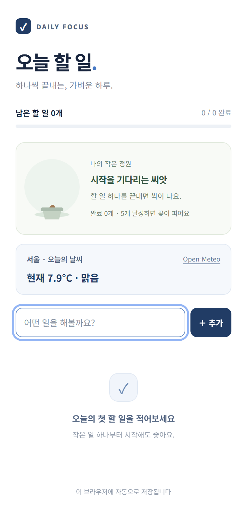

# 오늘 할 일 작성기 · Daily Focus

## 한 줄 소개

오늘 할 일을 끝낼수록 새싹이 자라 꽃이 되는, 날씨와 플로팅 버튼을 갖춘 할 일 작성기입니다.

## 누구를 위해 만들었나요

웹에서 작업하면서 오늘의 할 일을 자주 확인하고, 작은 성취를 눈으로 느끼고 싶은 사람을 위해 만들었습니다.

## 주요 기능

- 할 일 추가·삭제·완료 체크, 남은 개수와 완료율 표시, 브라우저에 자동 저장
- 일반 웹페이지 오른쪽 아래 플로팅 버튼으로 할 일 창 열기·닫기
- 서울의 현재 기온과 날씨 표시, 완료한 할 일 5개를 기준으로 씨앗에서 꽃까지 성장

## 화면

## 강사 예시에서 바꾼 점

- 네이비와 화이트를 중심으로 디자인을 정리하고 새싹 아이콘을 추가했습니다.
- 팝업을 닫아도 웹페이지에서 할 일을 다시 열 수 있도록 플로팅 버튼을 추가했습니다.
- Open-Meteo API로 서울 날씨를 표시하고, 로딩·실패 상태를 안내합니다.
- 씨앗 → 새싹 → 잎 → 줄기 → 꽃봉오리 → 꽃의 성장 모습을 넣었습니다.
- 긴 할 일의 줄바꿈과 저장 실패 안내를 추가했습니다.

## 써 보는 법

1. Chrome의 chrome://extensions에서 개발자 모드를 켜고, 압축해제된 확장 프로그램 로드로 이 폴더를 선택합니다.
2. 도구 모음 아이콘이나 일반 웹페이지 오른쪽 아래의 ‘할 일’ 버튼으로 창을 열고 할 일을 추가합니다.
3. 완료 체크로 식물을 키웁니다. 현재 목록에서 완료한 일이 5개 이상이면 꽃이 피고, 완료 해제·삭제 시 성장 단계가 조정됩니다.

플로팅 버튼은 일반 HTTP/HTTPS 웹페이지에서 작동하며 새 탭, 브라우저 설정, 웹스토어, 바탕화면에는 표시되지 않습니다. 버튼이 보이지 않으면 확장 프로그램의 사이트 접근 허용 상태를 확인하고 해당 웹페이지를 새로고침해 주세요.

## 다음에 붙이고 싶은 기능

- 날씨를 표시할 도시 선택
- 할 일 마감일과 알림

## 만들면서 배운 점

화면 구성, 디자인, 동작을 각각의 파일로 나누어 관리할 수 있다는 점을 배웠습니다. 플로팅 버튼은 팝업과 별개로 웹페이지에서 실행되어야 하며, API 요청에는 로딩과 오류 처리가 필요하다는 점도 알게 되었습니다.
