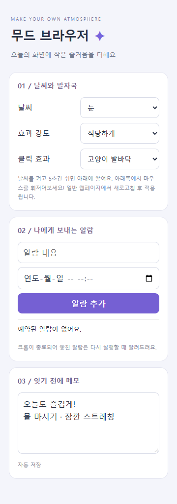
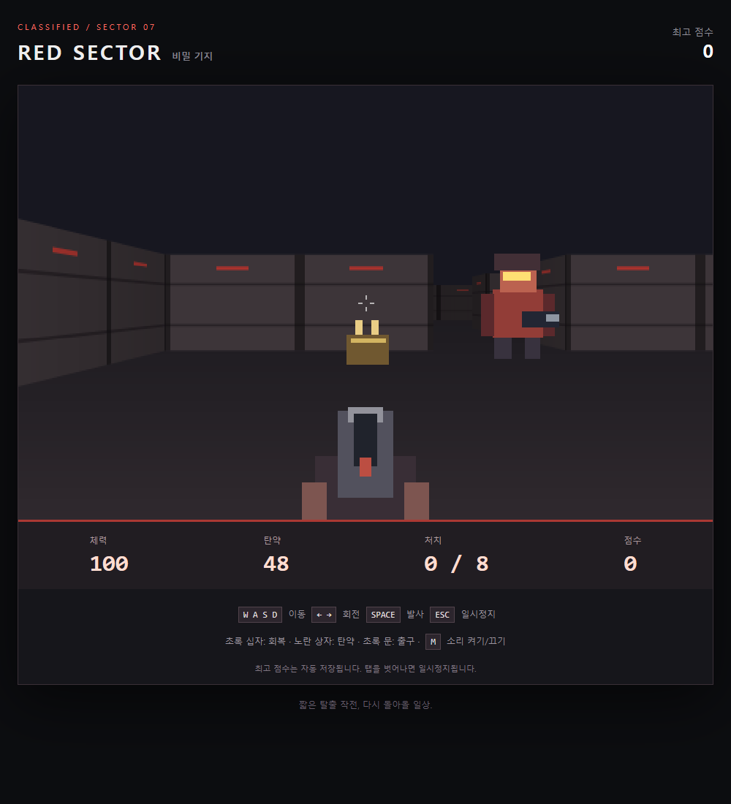

# 무드 브라우저

제출 닉네임: 홍성문 · 1라운드

## 한 줄 소개

날씨와 동물 발바닥으로 브라우저를 꾸미고, 알람·메모와 숨겨진 레트로 슈팅 게임을 즐기는 확장 프로그램입니다.

## 누구를 위해 만들었나요

웹서핑이나 게임을 하면서 화면을 꾸미고, 쉬는 시간과 간단한 메모를 관리하고 싶은 사람을 위해 만들었습니다.

## 주요 기능

- 비·눈·벚꽃과 강아지·고양이 클릭 효과를 선택하고 강도를 조절합니다.
- 5초 동안 조작하지 않으면 화면 아래에 날씨가 쌓이며, 마우스로 휘저으면 흩어집니다.
- 날짜·시간 알람과 자동 저장 메모장을 제공합니다.
- 메모장에 `/doom`을 한 줄로 입력하면 직접 만든 1인칭 레트로 슈팅 게임이 실행됩니다.
- 게임은 WASD 이동, 방향키 회전, Space 발사를 지원하며 체력·탄약·적·회복 아이템과 최고 점수 저장 기능이 있습니다.

## 화면

캡처에는 개인정보가 없는 예시 메모를 사용했습니다.

## 강사 예시에서 바꾼 점

- 기본 할 일 작성기 아이디어에서 확장해 브라우저 꾸미기와 알람·메모를 중심으로 새롭게 구성했습니다.
- Canvas로 날씨·쌓임·마우스 흩날림 효과를 구현했습니다.
- 별도 커맨드 입력창 없이 메모장에 비밀 커맨드를 입력하도록 구성했습니다.
- 직접 그린 그래픽과 레이캐스팅으로 미로 탈출 게임을 구현했습니다. 원작 둠의 이미지·음원을 사용하지 않습니다.

## 써 보는 법

1. `chrome://extensions`에서 개발자 모드를 켜고 이 폴더를 압축해제된 확장 프로그램으로 로드합니다.
2. 일반 웹페이지를 새로고침하고 팝업에서 날씨·클릭 효과를 켭니다. 5초간 쉬고 화면 아래에서 마우스를 움직여 봅니다.
3. 메모장에 `/doom`을 한 줄로 입력하면 게임이 열립니다. 적 8명을 처치하고 초록색 출구에 도착하면 성공입니다.

크롬 내부 화면·웹 스토어 등에서는 날씨 효과가 실행되지 않습니다. 운영체제의 모션 줄이기 설정이 켜져 있으면 움직이는 효과가 표시되지 않습니다. 알람은 크롬 및 운영체제 알림 허용이 필요하며, 종료 중 놓친 알람은 다음 실행 때 안내합니다. 모든 설정과 기록은 로컬에 저장합니다.

## 다음에 붙이고 싶은 기능

- 날씨 효과의 색상과 쌓이는 시간을 직접 조절하는 설정
- 게임 맵과 무기 종류 추가

## 만들면서 배운 점

웹페이지 위에 클릭을 방해하지 않는 효과를 그리는 방법과 크롬 저장소·알람 API를 활용하는 방법을 실습했습니다. 게임과 날씨 효과를 구현하면서 애니메이션, 충돌 판정, 일시정지, 입자 수 제한을 함께 고려했습니다.

